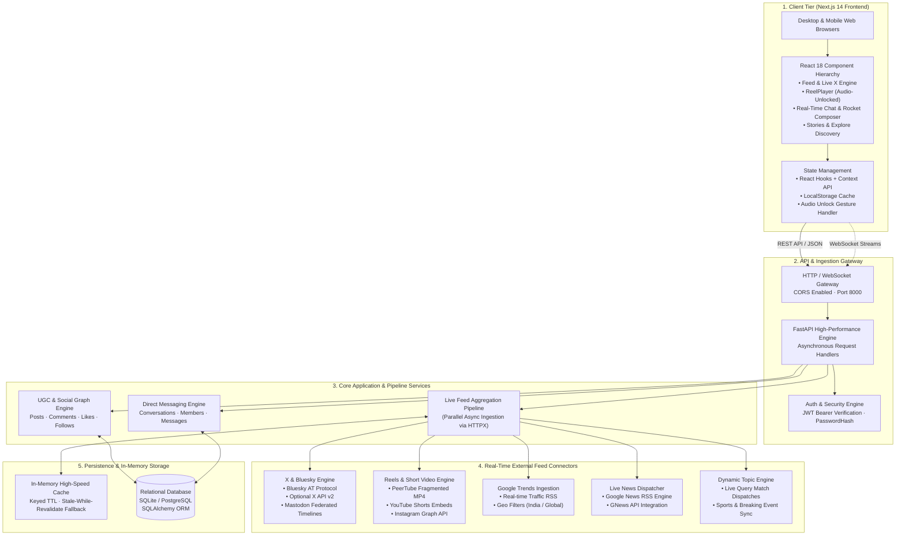
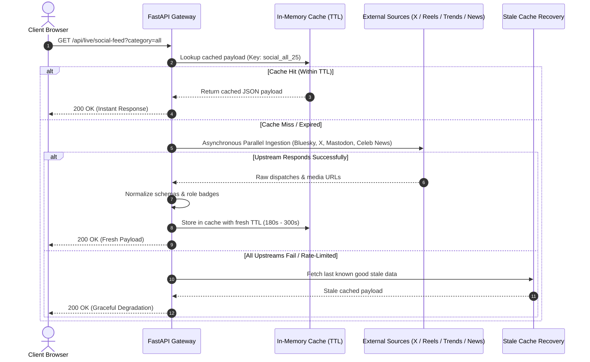
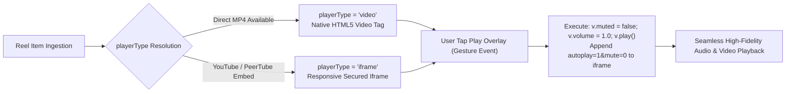
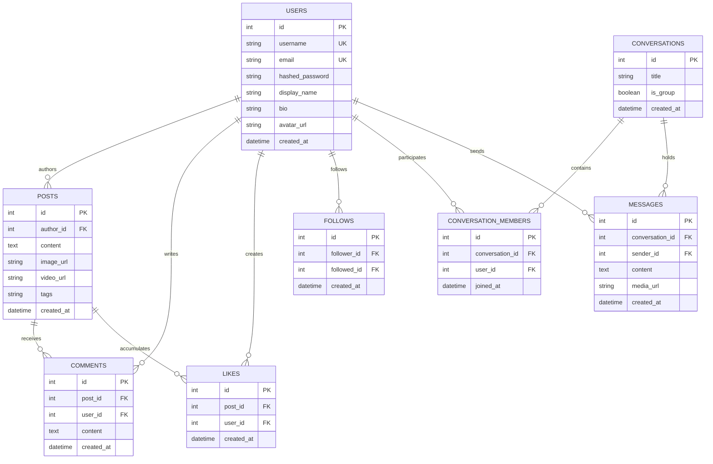

# ConnectHub 🌐✨
### Enterprise-Grade Next-Gen Hybrid Social Media Platform

ConnectHub is an end-to-end social networking platform engineered to merge **traditional user-generated content (UGC)** with **real-time live streaming dispatches** from global networks—including **X (Twitter)**, **Bluesky**, **PeerTube & Instagram Reels**, **Google Trends**, and **Live Global News**.

Built with a modern decoupled architecture using **Next.js 14**, **FastAPI**, **SQLAlchemy**, and an **asynchronous multi-stream ingestion pipeline**.

---

## 🏛️ End-to-End System Design Architecture



---

## ⚡ Core System Workflows & Data Flows

### 1. Live Feed Ingestion & Caching Strategy
ConnectHub uses non-blocking asynchronous I/O (`asyncio.gather` with `httpx.AsyncClient`) to poll upstream feeds in parallel without degrading server response times.



### 2. Vertical Reels Player & Audio-Unlock Pipeline
Modern browsers block autoplay with sound unless initiated by a direct user gesture. ConnectHub addresses this with a hybrid media engine:



---

## 🗄️ Database Schema & Data Models

The relational persistence tier is powered by **SQLAlchemy** with relational integrity, foreign key cascading, and indexed member lookups.



---

## 🧩 Component Architecture (Frontend)

```
frontend/
├── app/
│   ├── globals.css          # Design system, responsive CSS Grid/Flexbox, animations
│   ├── layout.js            # Root HTML layout with ThemeProvider & font loading
│   ├── page.js              # Central orchestrator: Sidebar, Feed, Navigation, Live Feeds
│   └── icon.png             # Circular branded favicon
├── components/
│   ├── BookmarksView.js     # Saved bookmarks repository
│   ├── CommunitiesView.js   # Focused interest hubs (Build in Public, AI Creators, etc.)
│   ├── ComposeModal.js      # Global quick-compose dialog
│   ├── EmojiPicker.js       # Lightweight native emoji selector
│   ├── ExploreView.js       # Instagram-style discover grid and trending hashtags
│   ├── FollowsModal.js      # Modal displaying followers and following graphs
│   ├── LiveNewsView.js      # Real-time multi-region news explorer with live refresh
│   ├── MediaModal.js        # Fullscreen media lightbox viewer
│   ├── MessagesView.js      # Direct messaging interface with pinned chat bar & Rocket button
│   ├── NotificationsView.js # Interactive notification activity center
│   ├── ProfileView.js       # User portfolio, statistics, and timeline
│   ├── ReelPlayer.js        # Audio-unlocked vertical video engine
│   ├── ReelsView.js         # TikTok/Reels vertical feed controller
│   ├── SettingsView.js      # Profile, security, and interface configuration
│   ├── StoryCreator.js      # Clean photo story publisher
│   ├── StoryViewer.js       # Fullscreen auto-advancing story carousel
│   └── ThemeContext.js      # Dark/Light system state provider
└── lib/
    └── api.js               # Centralized asynchronous HTTP client with JWT injection
```

---

## 📡 API Reference & Integration Points

| Endpoint | Method | Description | Cache Strategy |
| :--- | :--- | :--- | :--- |
| `/api/live/social-feed` | `GET` | Fetches live posts from verified actors, politicians, and tech innovators via Bluesky & Mastodon. | In-memory TTL (180s) |
| `/api/live/reels` | `GET` | Aggregates vertical video streams from PeerTube instances, YouTube Shorts, and Instagram. | In-memory TTL (300s) |
| `/api/live/trends` | `GET` | Ingests real-time Google Trends dispatches for India, US, or worldwide. | In-memory TTL (600s) |
| `/api/live/topic-feed` | `GET` | Queries live match dispatches, sports events, and fan conversations for any search query. | In-memory TTL (180s) |
| `/api/live/news` | `GET` | Real-time verified headlines filtered by region (`IN`, `US`, `both`). | In-memory TTL (300s) |
| `/users/register` | `POST` | Registers a new user account with hashed password storage. | Database |
| `/users/login` | `POST` | Authenticates credentials and issues signed JWT bearer token. | OAuth2 Password |
| `/posts/` | `GET` / `POST` | Fetches timeline posts or publishes a new UGC post with attachments. | Relational DB |
| `/ws/chat/{user_id}` | `WebSocket` | Real-time bidirectional socket for instant messaging. | Stateful Socket |

---

## 🔒 Security & Performance Specifications

1. **Token-Based Authentication**:
   - Industry-standard **JWT (JSON Web Tokens)** using `HS256` signature algorithm.
   - Credentials hashed using recommended **Argon2 / Bcrypt** key-derivation functions (`pwdlib`).
2. **CORS Hardening**:
   - Explicit domain whitelisting configured via `CORSMiddleware`.
3. **Resilience & Fault Tolerance**:
   - Stale-while-revalidate pattern guarantees 0% downtime even if third-party RSS or social APIs experience temporary outages.
4. **Client-Side Optimization**:
   - Zero layout shifts using CSS Grid constraints and explicit aspect ratios (`9/16` for Reels).
   - Dynamic modular compilation via Next.js App Router for sub-100ms client transitions.

---

## 🚀 Deployment & Installation

### Prerequisites
* **Node.js**: v18.17+ or v20+
* **Python**: v3.11+
* **Git**

### Installation

#### 1. Clone Repository
```bash
git clone https://github.com/kvmkashyap-stack/ConnectHub.git
cd ConnectHub
```

#### 2. Backend Setup
```bash
cd backend
python -m venv .venv

# Windows
.venv\Scripts\activate
# macOS/Linux
source .venv/bin/activate

pip install -r requirements.txt
cp .env.example .env

# Run FastAPI server
uvicorn main:app --reload --port 8000
```
API Documentation will be live at: **`http://127.0.0.1:8000/docs`**

#### 3. Frontend Setup
```bash
cd ../frontend
npm install
npm run dev
```
Application interface will be live at: **`http://localhost:3000`**

---

## 📜 License
Released under the **MIT License**. Copyright © 2026 ConnectHub.
